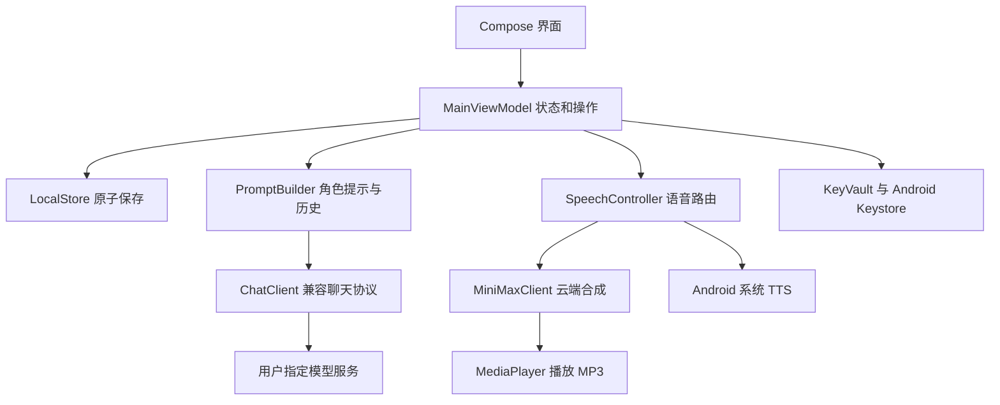
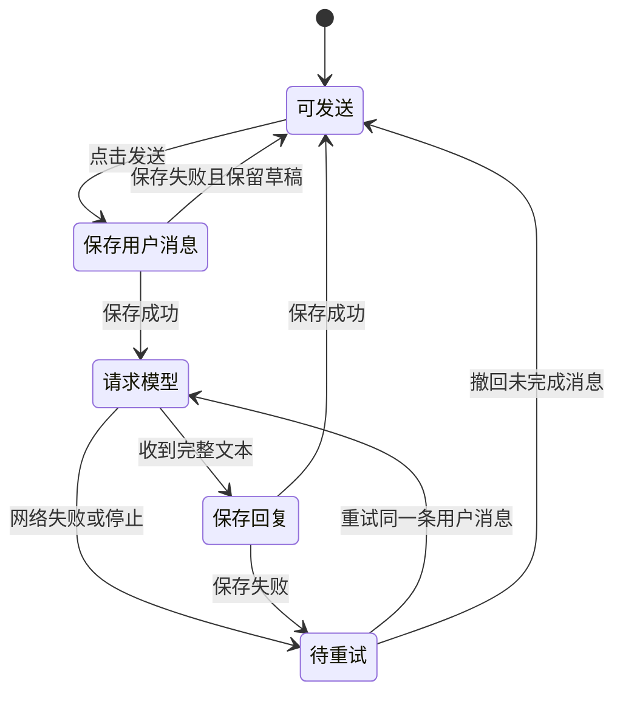

# 架构与程序原理

## 0.3.8 展示模式与夜间玻璃层

ChatScreen 将切换胶囊放在消息滚动区外，按会话 ID 与展开状态分别建立 LazyListState/布局，统一渲染完整或最新一轮的消息窗口；模式切换不保留移除动画图层。打字机进度位于会话级状态，历史收起不改变持久化或 API 上下文。NightScene 提供静态夜景、共享高斯缓存和 LocalNightGlass；SectionCard 对同一背景按全局坐标取样，弱化边缘，复用 Android 8+ 绘制路径。ApiSetupGuide 只提供引导和官网跳转，不接触密钥保存。详细原理、来源和验证边界见 NIGHT_AND_HISTORY_FIX。

## 品牌资源与功能边界（2026-11-24）

名称“映语”与正式图标已接入；三款最初候选及提示词保留于工程同级 Yingyu-Icon-Concepts。品牌更名沿用 applicationId、签名与数据路径，不改变聊天、语音和存储协议；原始设计历史见 BRAND_DESIGN。

本工程将人物、聊天、语音和存储分开。角色声音由独立语音服务生成，聊天模型负责生成文本，因此聊天 API 不需要原生支持语音。

## 模块与数据流

| 文件 | 责任 |
| --- | --- |
| MainActivity.kt | 「映语」主题与浅紫蓝环境底色、品牌人物列表（含删除确认）、分卡片编辑/设置表单与沉浸式悬浮聊天界面（长按气泡菜单、音量图标开关与底部胶囊输入栏） |
| ui/AppIcons.kt | 零依赖 Compose Canvas 矢量图标（音量/静音、返回、菜单、声波、灯泡提示、发送与停止） |
| ui/Motion.kt | `Modifier.bounceClick` 弹簧回弹、`StaggeredEntrance` 交错入场、`rememberShimmerAccentBrush` 流动渐变、`TypingDotsIndicator` 弹跳等待点与 `SpeakingAvatarAura` 朗读脉冲光环 |
| ui/Typewriter.kt | `TypewriterPacing` 模拟逐字打字节奏控制（标点停顿、长文自动提速、括号旁白略快） |
| voice/SpeechTextFilter.kt | 朗读前过滤中英文括号、方括号与星号旁白，仅保留实际台词 |
| MainViewModel.kt | 控制加载、串行修改、请求状态、重试、持久化和取消 |
| domain/Models.kt | 人物卡、声音、会话、消息、API 配置 |
| domain/PromptBuilder.kt | 把角色快照与最近几轮历史组成模型消息 |
| data/LocalStore.kt | JSON 版本文件的原子读写 |
| data/AppDataCodec.kt | v1/v2 识别、旧字段补全与显式版本编码 |
| data/KeyVault.kt | 独立 Key 的 AES-GCM 加密与解密 |
| network/ChatClient.kt | 请求聊天接口，验证并读取文本响应 |
| network/ApiFailure.kt | 有界提取服务端错误、已知密钥脱敏与网络故障分类 |
| network/MiniMaxClient.kt | 请求语音接口，检查业务错误与解码音频 |
| voice/SpeechController.kt | 语音提供商选择、请求取消、音频播放和文件清理 |
| voice/SystemVoiceEngine.kt | 系统引擎初始化、音色枚举与朗读 |
| appearance/WallpaperStore.kt | 私有壁纸导入、解码、方向纠正和默认背景 |
| appearance/GaussianBlur.kt | 可分离高斯卷积，处理壁纸的 RGB 像素 |
| appearance/GlassBackdrop.kt | 共享背景模糊、局部取样、陀螺仪视差同步与玻璃边缘绘制 |
| appearance/WallpaperParallax.kt | 生命周期感知陀螺仪/加速度计视差滤波（动态握姿归零、前台监听、后台自动释放） |

## 人物卡如何影响回复

新建对话时复制人物卡到 Conversation.character。PromptBuilder 使用该快照的名字和设定生成 system 消息。简介用于展示，开场白作为首条 assistant 消息保存在本地会话中；语音配置不发送给聊天模型。0.2.1 发送时将开头尚无对应用户轮次的开场白转为 system 内的已说过内容，不以独立 assistant 作为首个 API 对话轮次；原始记录不修改。

每次发送时，先保存 user 消息，再提交 system + 最近 N 轮历史。历史以 user 消息为切分边界，避免只留下旧回答却丢失对应问题。system 始终保留，旧历史内的 system 条目不转发。全部历史能容纳时在 system 中保留开场白上下文，否则随旧轮次移除。请求历史从 user 开始，并以当前 user 结束。

角色扮演取决于所选模型的能力和服务策略；提示词不能保证所有模型完全遵循设定。轮数也不等于 token 数，长设定或长回复仍可能超过模型上下文，下一阶段需加入模型相关 token 预算。

## 聊天请求与恢复

客户端使用 HTTPS 与 Bearer Key，关闭自动重定向和透明连接重试。配置基础地址后追加 chat/completions，先采用非流式返回。仅接受 choices[0].message.content 的文本；其他协议、多模态内容块、工具调用和只输出推理内容的模型需要专门适配。

0.2.1 在精确主机 api.deepseek.com 上增加 thinking.type=disabled，显式使用普通聊天；其他主机不携带该参数。成功响应支持字符串正文，以及 type=text 的文本块数组；不处理工具调用。通过注入 OkHttp 传输编写模拟响应测试，不需要真实 Key。

GET /models 的测试连接使用当前表单地址和输入 Key，留空 Key 时读取已保存 Key，不发送人物和聊天记录，也不自动保存配置。返回的模型列表只放在内存，并和测试时的基础地址关联，避免切换地址后使用过时列表。选择模型后仍需保存。

HTTP 错误最多读取 16 KiB，仅提取 message/code/type 与请求编号等字段，不展示整段原始响应。ApiFailure 传给全局弹窗并允许复制；字段有长度限制且替换已知 Key、Bearer 和常见 sk- 密钥串，不写入数据文件或日志。格式错误、认证、余额、限流、DNS、TLS 与超时分别提示。模型发现成功不代表生成额度可用，也不等同于实际聊天已成功。

取消通过协程传递到 OkHttp Call.cancel。远端已受理的请求仍可能计费，因此不自动反复重试。若回复已经到达但落盘失败，原型尚不能恢复该回复，重试可能产生另一条答案；该限制已列入后续改进。

## 保存、线程与生命周期

应用私有 noBackupFilesDir 中保存带 schemaVersion 的 JSON。小型原型用一次完整快照，写入 AtomicFile 后才发布新 UI 状态。加载或解析失败不会创建空数据覆盖原文件；不认识的版本停止写入。

0.2.0 增加 appearance，格式升到 v2。读取 v1 时先保留原始字节副本再迁移；旧版省略的 schemaVersion 按 v1 处理。版本编码与文件读写分开，便于单元检查。物理文件名继续保留 rolechat-v1.json，逻辑版本由文件内 schemaVersion 决定。

ViewModel 将数据修改串行化：busy 在启动协程前设置，保存或请求结束后解除。磁盘与密钥操作在 IO 线程执行，网络使用 OkHttp 异步调用。保存提交使用 NonCancellable 小范围保护，保证取消时落盘状态与内存状态保持一致。

屏幕旋转由 ViewModel 保留会话状态；表单和消息草稿用 rememberSaveable。Key 输入只放在普通 remember 中，不写入 Android 保存状态。进程死亡后依靠磁盘恢复已保存内容，未提交的后台请求不会自动重放。

原型整个 JSON 会随着消息增长变大，尚未设置总数据量限制或分页。长期聊天、全文搜索和批量删除前，迁移到 Room，按版本导入并保留原文件作为恢复副本。

## 两类语音的工作方式

云端：点击朗读或试听 → 获取独立语音 Key → 提交文本、模型 ID 和角色 voiceId → 检查 HTTP 与供应商业务状态 → 把十六进制音频解码为 MP3 → 写入应用缓存 → MediaPlayer 播放。完成、失败、取消时释放播放器并删除临时文件。新朗读会停止上一段。异常进程退出可能遗留缓存，后续需加入启动清理与容量限制。

当前云端每次限制 1500 个字符，采用完整音频后播放，没有边合成边播放。默认模型 speech-2.8-hd，0.2.3 支持在软件内选择预置中文音色或通过 `/v1/get_voice` 拉取账号音色（系统/克隆/生成），并向 `t2a_v2` 传递 `voice_setting.speed`、`voice_setting.pitch`（`-12..12`）、可选 `voice_setting.emotion` 及非零时的 `voice_modify`（`timbre` / `intensity`，`-100..100`）。`TtsApiConfig.autoSpeak` 控制收到新回复后是否自动触发朗读（默认关闭，仅在 `send` 保存新回复后触发，不重放历史消息）。0.2.2/0.2.3 在 MiniMax 业务失败时保留脱敏后的 `base_resp.status_msg`（通过 `ApiFailures.clean` 隐藏密钥/Bearer/sk- 并限制长度），并在设置页提供国内站（`api.minimaxi.com`）与国际站（`api.minimax.io`）快捷地址按钮。

系统：通过 TextToSpeech 枚举设备默认引擎可用音色，按 voiceId 选择；空 ID 自动选择中文。开启“只使用离线音色”时过滤 isNetworkConnectionRequired。没有可用离线音色时给出提示，不悄悄换成联网声音。系统语音是否可用依赖设备引擎和已安装资源。

内置 ONNX 模型尚未集成，但可安装 sherpa-onnx 的系统 TTS 引擎，再由本应用的系统语音路径访问；具体音色切换能力必须真机验证。LOCAL_ONNX 枚举为后续扩展预留，当前界面不开放该选项。

## 密钥与边界

聊天、语音各自使用一个 KeyVault 文件和 Android Keystore 别名。AES-GCM 每次使用随机 IV，应用数据 JSON 不含 Key。禁用系统应用备份，密钥输入不写入日志或持久化 UI 状态。设备受控或被破解时，客户端持有的密钥仍可能被提取；本方案适合用户使用自己的 Key。

如果以后改为开发者统一付费，应新增后端代理、用户鉴权、额度限制和密钥托管，不把公共计费 Key 打包在 APK 里。该后端尚未实现。

配置与密钥是两次独立提交，不提供跨文件事务；极少数密钥写入失败时配置可能已保存，界面报告错误，用户可重新保存密钥。聊天的重试机制不等于语音重试，二者互不影响。

## 聊天壁纸与玻璃材质

聊天页使用清晰壁纸作为最底层。0.3.2 将壁纸与头像拆分为每张人物卡独立字段（`CharacterCard.wallpaperFile` / `avatarFile`，未设时回退到全局壁纸），替换或删除角色时通过引用计数安全清理无引用文件；角色头像默认以 `TopCenter` 裁剪展示壁纸人物，亦可在人物卡编辑页单独自定义。0.2.2 起聊天路由释放 `Scaffold` 系统栏内边距让壁纸全屏铺底，内部栏位避让系统区域并随字体色亮度同步状态栏图标色。共享一张后台计算的低分辨率高斯模糊缓存；各气泡（手机端限制最大宽度为视口 84%、上限 560dp 以清晰区分左右消息）与输入栏按自己的全局位置，从同一壁纸裁剪映射取样，在圆角内绘制，再叠薄色与高光边缘。文字与按钮（含禁用态颜色与边框）最后绘制，不参与模糊。滚动只更新位置取样，不逐条重新计算模糊。

采用普通位图与 Canvas 绘制，Android 8.0 起走同一路径，无需 Android 12 的背景窗口模糊能力。图片解码在 Android 9 起使用 ImageDecoder，旧版本走 BitmapFactory 与 EXIF 方向修正。完整算法、性能边界与实测项目见 GLASS_DESIGN。

## 构建与测试包交付

2026-11-24 首次执行 testDebugUnitTest 与 assembleDebug 成功，19 项单元测试通过。JDK 17、Android SDK 35、Build Tools 35.0.0、Gradle 8.11.1 均放在当前工作区的便携构建目录中。JAVA_HOME、ANDROID_HOME、ANDROID_USER_HOME 与 GRADLE_USER_HOME 只对构建进程设置，不改系统全局环境。

Gradle 启动入口读取 JAVA_OPTS 与 GRADLE_OPTS，便于代理和隔离目录设置；Wrapper 仍验证固定的官方 SHA-256，下载超时改为 60 秒。调试签名由 Android 构建工具生成，APK 通过 v2 签名验证与 ZIP 对齐检查。源代码压缩包排除编译缓存、build 目录和签名密钥。

调试密钥位于工作区的 android-build/android-user 目录，必须保留以便后续覆盖安装，不放入公开源码包。该签名用于当前开发测试，公开商店发布前仍需规划正式签名与升级路径。桌面单元测试不覆盖手机上的玻璃渲染、音频播放、系统 TTS、文件迁移和真实网络服务。

## 外部真机调试层

电脑上的 ADB 通过已授权的 USB 调试连接手机，承担安装、启动和应用日志；Mobile MCP 提供结构化 AI 工具，scrcpy 辅助投屏与键鼠输入；固定回归后续可考虑 uiautomator2。这些开发工具不打包到 APK。当前 Mobile MCP 1.0.19、scrcpy 5.0.1、ADB 37.0.3 已安装，ADB 和独立 MCP 已识别华为真机，APK 安装成功，UI 操作尚未验证。

工具固定保存于 `<tools-dir>/mobile-control`。本地 CJS launcher 用 Node 24 启动固定 npm 包，通过 stdio 与客户端交换 MCP JSON-RPC；进程专用 ANDROID_HOME/ADB/PATH 指向便携 SDK，关闭支持的遥测标志，cwd 限定当前工作区。已在 Codex 全局配置登记；当前会话原生工具清单未热加载，独立探测证明服务与设备枚举可用。

选型补充：AI 持续自动调试优先考虑 Mobile MCP，先复用 ADB 建立连接，scrcpy 作为辅助画面。Mobile MCP 与 uiautomator2 的普通 UI 调试路径不依赖 root，使用 ADB/UiAutomator 及设备授权；这不等于拥有任意系统权限。
